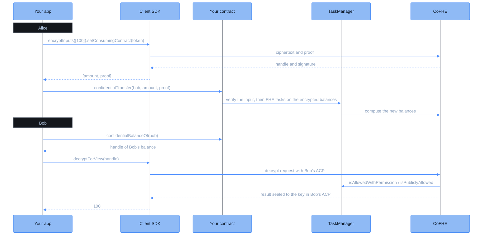

Alice pays Bob 100 tokens. Everyone can see that Alice paid Bob. Only Alice and Bob can see how much. Each of them can read only their own balance. This tutorial builds that payment end to end: the token contract, the encrypted transfer, and Bob reading his balance. You run every step on your machine first, then on Sepolia.

## What stays private

| Information | Who can read it |
| --- | --- |
| That Alice sent a transfer to Bob, and when | Anyone |
| That an account sent or received transfers, through a public activity counter | Anyone (see the note below) |
| The token contract, its code, and the 1,000-token mint in the constructor | Anyone |
| The amount of the transfer | Alice and Bob |
| Alice's balance | Alice |
| Bob's balance | Bob |

The amount travels encrypted from Alice's machine to the chain, and it stays encrypted onchain. The contract adds and subtracts encrypted values. CoFHE decrypts a value only for an account the contract allowed to read it.

<Note>
This example mints a constant, so its starting supply is public. A real token mints from an encrypted input when the amount must stay private.

Etherscan shows each transfer as `79,840,001 CTK`, and `balanceOf` returns numbers near 79,840,000. These are not amounts. FHERC20 reports an activity counter in place of the public ERC-20 fields, so wallets and explorers can show that something happened without the amount. See [FHERC20](/cofhe/fhe-library/confidential-contracts/fherc20/overview).
</Note>



## Run it first

The example is a complete Hardhat project. Download it and run its test before you read any code. The test runs on local mocks, so you need no wallet and no testnet.

<Note>
You need Node.js 20, 22, or 24. The first run downloads the Solidity compiler, and Hardhat may ask once whether to send anonymous telemetry. The compiler prints two warnings about the CoFHE mock contracts, one about transient storage and one about code size. Both are expected: the mocks run only in local tests.
</Note>

```bash
npx degit FhenixProtocol/fhenix-docs/cofhe/tutorials/examples/confidential-transfer my-payment
cd my-payment
npm install
npm test
```

<Check>
The test prints `2 passing`: one test for the payment, one for a payment larger than the balance.
</Check>

The project pins `@cofhe/sdk` and `@cofhe/hardhat-plugin` `1.0.1`, `fhenix-confidential-contracts` `1.0.0`, and `@fhenixprotocol/cofhe-contracts` `1.0.0`. See [compatibility](/cofhe/get-started/introduction/compatibility) for why these versions go together. You can also [browse the project on GitHub](https://github.com/FhenixProtocol/fhenix-docs/tree/main/cofhe/tutorials/examples/confidential-transfer).

The rest of this page walks through the code, in the order it runs.

## The token

The token inherits `FHERC20` from [`fhenix-confidential-contracts`](/cofhe/fhe-library/confidential-contracts/overview). `FHERC20` stores every balance as an encrypted `uint64`, and does the encrypted arithmetic for each transfer. The constructor mints 1,000 tokens to the account that deploys it: Alice.

{/* example: cofhe/tutorials/examples/confidential-transfer/contracts/ConfidentialToken.sol#contract */}
```solidity contracts/ConfidentialToken.sol
// SPDX-License-Identifier: MIT
pragma solidity ^0.8.25;

import { FHE } from "@fhenixprotocol/cofhe-contracts/FHE.sol";
import { FHERC20 } from "fhenix-confidential-contracts/contracts/FHERC20/FHERC20.sol";

/// A token whose balances and transfer amounts are encrypted.
contract ConfidentialToken is FHERC20 {
    constructor() FHERC20("Confidential Token", "CTK", 0, "") {
        // 0 decimals: whole tokens keep the numbers in this example simple.
        _mint(msg.sender, FHE.asEuint64(1_000));
    }
}
```

That is the whole contract. Transfers, balances, and access control come from `FHERC20`.

## Set up the three accounts

The test uses three accounts. Alice pays, Bob receives, and Eve plays an outsider who tries to read Bob's balance. Each person gets a CoFHE client, which encrypts their inputs and decrypts the values they are allowed to read.

{/* example: cofhe/tutorials/examples/confidential-transfer/test/alice-to-bob.test.ts#setup */}
```typescript test/alice-to-bob.test.ts
const [alice, bob, eve] = await hre.ethers.getSigners();

// Alice deploys the token. The constructor mints 1,000 tokens to her.
const token = await hre.ethers.deployContract('ConfidentialToken', [], alice);
const tokenAddress = await token.getAddress();

// One CoFHE client per person. In tests, the plugin creates it connected.
const aliceClient = await hre.cofhe.createClientWithBatteries(alice);
const bobClient = await hre.cofhe.createClientWithBatteries(bob);
const eveClient = await hre.cofhe.createClientWithBatteries(eve);
```

`createClientWithBatteries` creates a client, connects it to the signer, and signs an [Access Control Permission (ACP)](/cofhe/client-sdk/guides/acps) for it. It works only on the Hardhat mocks. On a real network you create the client yourself, as the [Sepolia step](#run-it-on-sepolia) shows.

## Alice encrypts the amount

Alice encrypts 100 on her own machine. The plaintext never leaves it.

{/* example: cofhe/tutorials/examples/confidential-transfer/test/alice-to-bob.test.ts#encrypt */}
```typescript test/alice-to-bob.test.ts
// Alice encrypts the amount on her machine, for this token contract only.
const [amount, proof] = await aliceClient
  .encryptInputs([Encryptable.uint64(100n)])
  .setConsumingContract(tokenAddress)
  .execute();
```

`setConsumingContract` binds the encrypted input to the token. The proof is valid only when Alice submits it to this contract. Anyone who copies the ciphertext cannot use it anywhere else. See [encrypting inputs](/cofhe/client-sdk/guides/encrypting-inputs) for the details.

## Alice sends it

Alice calls `confidentialTransfer` with Bob's address, the encrypted amount, and the proof.

{/* example: cofhe/tutorials/examples/confidential-transfer/test/alice-to-bob.test.ts#transfer */}
```typescript test/alice-to-bob.test.ts
// The amount goes onchain encrypted. Everyone sees the transfer, nobody sees how much.
await token.connect(alice)['confidentialTransfer(address,bytes32,bytes)'](bob.address, amount, proof);
```

`confidentialTransfer` has two overloads, so ethers needs the full signature. The encrypted amount has the Solidity type `externalEuint64`, which is `bytes32` in the ABI.

## Bob reads his balance

`confidentialBalanceOf` returns a handle, not a number: a reference to Bob's encrypted balance. Bob's client asks CoFHE to decrypt it. The token allowed Bob to read his own balance during the transfer, so CoFHE returns the result sealed to the key in Bob's ACP. Only Bob's client can unseal it.

{/* example: cofhe/tutorials/examples/confidential-transfer/test/alice-to-bob.test.ts#bob-reads */}
```typescript test/alice-to-bob.test.ts
// Bob reads his balance: an encrypted handle, decrypted for his eyes only.
const bobBalance = await bobClient
  .decryptForView(await token.confidentialBalanceOf(bob.address), FheTypes.Uint64)
  .execute();
expect(bobBalance).to.equal(100n);

const aliceBalance = await aliceClient
  .decryptForView(await token.confidentialBalanceOf(alice.address), FheTypes.Uint64)
  .execute();
expect(aliceBalance).to.equal(900n);
```

Bob reads 100 and Alice reads 900. See [decrypt to view](/cofhe/client-sdk/guides/decrypt-to-view) for how the result reaches only Bob.

## Eve cannot read it

Eve can read Bob's handle, because the handle is public. She cannot decrypt it: the access control list (ACL) has no entry for her, so CoFHE refuses.

{/* example: cofhe/tutorials/examples/confidential-transfer/test/alice-to-bob.test.ts#eve-fails */}
```typescript test/alice-to-bob.test.ts
// Eve can fetch Bob's handle, but the ACL refuses to decrypt it for her.
const bobHandle = await token.confidentialBalanceOf(bob.address);
await expect(eveClient.decryptForView(bobHandle, FheTypes.Uint64).execute()).to.be.rejectedWith(/NotAllowed/);
```

On the mocks, the error message contains `NotAllowed`. See [access control](/cofhe/fhe-library/core-concepts/access-control) for who can read what.

## What if Alice sends more than she has?

<Warning>
A confidential transfer larger than the balance does not revert. It moves 0 tokens. A revert would tell everyone that the sender's balance is below the amount, so the token transfers nothing instead. To learn what moved, Alice decrypts the amount handle in the transfer's `ConfidentialTransfer` event. The one case that does revert is a sender that never held the token: `FHERC20ZeroBalance`.
</Warning>

{/* example: cofhe/tutorials/examples/confidential-transfer/test/alice-to-bob.test.ts#overdraw */}
```typescript test/alice-to-bob.test.ts
// Alice has 1,000 and tries to send 5,000. The transfer does not revert:
// a revert would tell everyone her balance is below 5,000. It moves 0 instead.
const [tooMuch, proof] = await aliceClient
  .encryptInputs([Encryptable.uint64(5_000n)])
  .setConsumingContract(tokenAddress)
  .execute();
await token.connect(alice)['confidentialTransfer(address,bytes32,bytes)'](bob.address, tooMuch, proof);

const aliceBalance = await aliceClient
  .decryptForView(await token.confidentialBalanceOf(alice.address), FheTypes.Uint64)
  .execute();
expect(aliceBalance).to.equal(1_000n);
```

## Run it on Sepolia

The same payment runs on Ethereum Sepolia. You need one test account for Alice, with some Sepolia ETH: she deploys the token and sends the transfer. Bob only signs messages, so the script creates a fresh wallet for him on each run.

<Steps>
<Step title="Add your keys">
Copy `.env.example` to `.env`, then fill in `ALICE_PRIVATE_KEY`. `SEPOLIA_RPC_URL` is optional: without it, the script uses a public Sepolia endpoint. If Alice's account has no Sepolia ETH, the script stops before it sends anything. `.gitignore` already excludes `.env`. Use a test account only.
</Step>
<Step title="Run the script">
```bash
npm run sepolia
```
The script deploys the token, sends the payment, and prints Bob's and Alice's balances, with Etherscan links to the token and the transfer.
</Step>
</Steps>

On a real network there are no plugin helpers. The script creates each client with the Node entry point of the SDK:

{/* example: cofhe/tutorials/examples/confidential-transfer/scripts/alice-to-bob.ts#sepolia */}
```typescript scripts/alice-to-bob.ts
async function connectedClient(wallet: ethers.BaseWallet) {
  const client = createCofheClient(createCofheConfig({ supportedChains: [chains.sepolia] }));
  const { publicClient, walletClient } = await Ethers6Adapter(wallet.provider!, wallet);
  await client.connect(publicClient, walletClient);
  // Signing an ACP once lets this wallet decrypt the values it is allowed to see.
  await client.acp.getOrCreateSelfACP();
  return client;
}
```

The encrypt, transfer, and decrypt calls are the same as in the test. See [client setup](/cofhe/client-sdk/guides/client-setup) for browsers and other wallets.

<Check>
The script prints `Bob's balance: 100` and `Alice's balance: 900`.
</Check>

## What's next

<CardGroup cols={2}>
<Card title="FHERC20" icon="lock" href="/cofhe/fhe-library/confidential-contracts/fherc20/overview">
Operators, transfer callbacks, and the rest of the token API.
</Card>
<Card title="Wrap an existing token" icon="box" href="/cofhe/fhe-library/confidential-contracts/fherc20/fherc20-wrapper">
Make a confidential version of USDC or ETH.
</Card>
<Card title="ACPs" icon="key" href="/cofhe/client-sdk/guides/acps">
Share read access with another account, or revoke it.
</Card>
<Card title="Your first FHE contract" icon="code" href="/cofhe/tutorials/your-first-fhe-contract">
Write encrypted logic of your own.
</Card>
</CardGroup>
