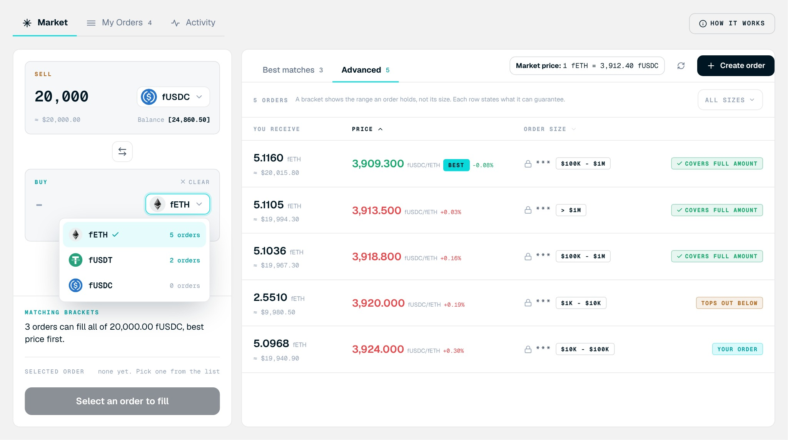

<Frame>

</Frame>

Select either side of the pair. To open it, select the token button in the **Sell** or **Buy** panel.

## Screen components

1. **Token rows.** Every token the venue has whitelisted on the current chain.
2. **Selected token.** Marked with a check.
3. **Order count.** How many open orders exist for that token, so you can find active pairs. Tokens with open orders appear at the top of the list.

## Steps

<Steps>
  <Step title="Open the selector">
    Open the token selector.
  </Step>
  <Step title="Pick the token">
    Select the token you want.
  </Step>
  <Step title="Recheck">
    Recheck the amount and the book after you change tokens.
  </Step>
</Steps>
