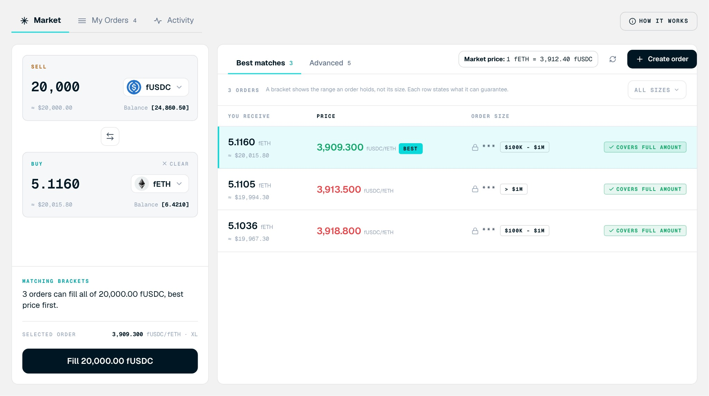
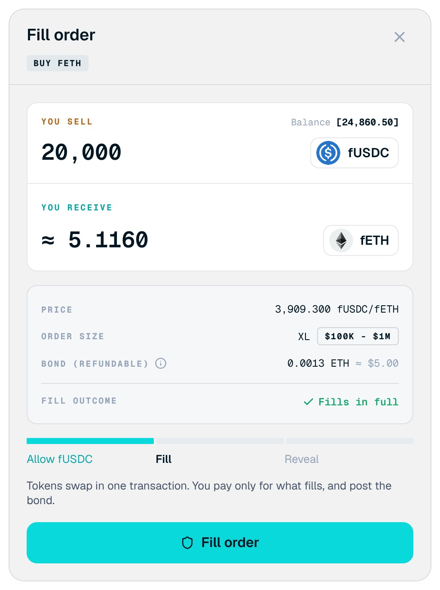

<Frame>

</Frame>
<Frame>

</Frame>

Fill an order you selected in the book. To open it, select an order on the **Market** tab, then select the **Fill** button in the intent panel.

## Screen components

1. **Matching brackets and selected order.** Confirms how many orders can fill your amount and which one you picked, with its price and size.
2. **Covers full amount.** Shown on a book row when the order can fill your whole amount.
3. **You sell and You receive.** Your payment and the approximate amount you get, at the order's price.
4. **Price and order size.** The maker's price and the order's public tier.
5. **Bond (refundable).** The ETH bond posted with the fill, with its dollar value.
6. **Fill outcome.** Whether the order fills your amount in full or in part.
7. **Step tracker.** Allow (for the token you pay with), Fill, and Reveal.
8. **Fill order button.** Starts the next required step.

## Steps

<Steps>
  <Step title="Review the order">
    Select an order and review what you receive, the price, and the tier.
  </Step>
  <Step title="Open the dialog">
    Select **Fill** and review the **Fill order** dialog.
  </Step>
  <Step title="Allow the token">
    Confirm **Allow** if prompted, so the OTC contract can take the token you pay with.
  </Step>
  <Step title="Fill">
    Confirm the fill in your wallet. Your payment and the maker's tokens swap atomically, and the bond is posted.
  </Step>
  <Step title="Reveal">
    Complete the reveal when prompted. This publishes the order's new tier and returns your bond in full.
  </Step>
  <Step title="Check the result">
    Check the result in [Activity](/trading/manage-orders/activity).
  </Step>
</Steps>

<Warning>
Confidential transfers are all or nothing. If your balance cannot cover the full payment, nothing is paid and nothing is released. Size the fill to what you can pay.
</Warning>
