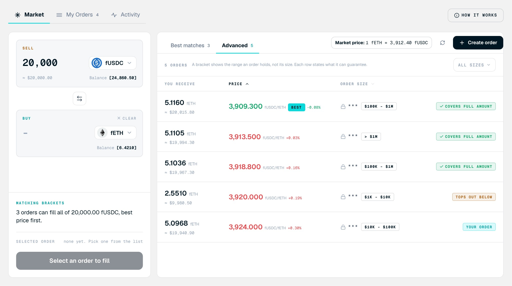

<Frame>

</Frame>

Browse the orders that could fill your amount. To open it, enter an amount on the **Market** tab.

## Screen components

1. **Best matches and Advanced.** Best matches lists orders from other makers that suit your amount. Advanced lists every open order on the pair, including your own.
2. **Market price.** The reference rate the book compares each order against. It is labeled Live when a price feed exists, and Reference when the venue's own price stands in.
3. **Refresh and Create order.** Reload the book, or post your own order instead of filling one.
4. **Size filter.** Narrow the book to one tier.
5. **You receive.** What the order would deliver for your amount, with its approximate dollar value.
6. **Price.** The maker's price and how far it sits from the market price.
7. **Order size.** The order's tier. A tier shows the range an order holds, not its exact size. Each row states what it can guarantee for your amount.
8. **Your order badge.** Marks orders you posted. You cannot fill your own orders.

## Steps

<Steps>
  <Step title="Compare the price">
    Check the price against the market price.
  </Step>
  <Step title="Check the tier">
    Check that the tier can cover your amount in full or in part.
  </Step>
  <Step title="Select an order">
    Select an order to load it into the fill panel.
  </Step>
</Steps>

<Note>
If an order cannot cover your whole amount, the fill is capped to what it holds, and you pay only for the part that fills.
</Note>
