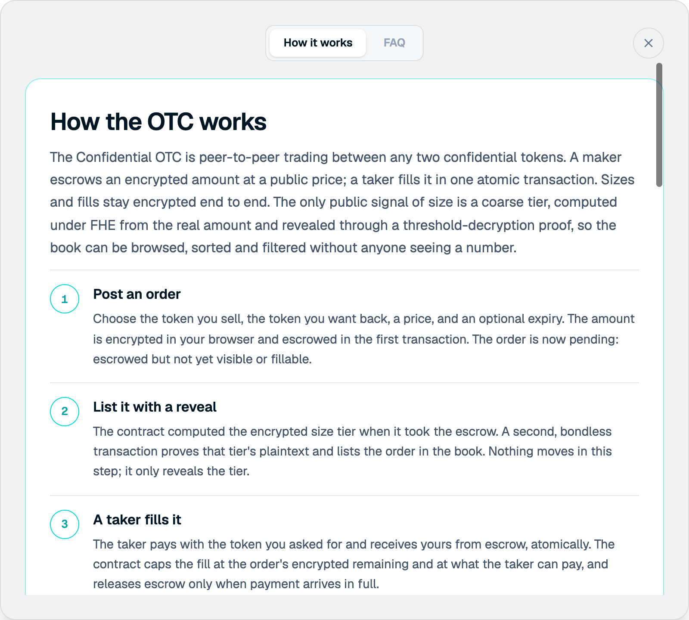
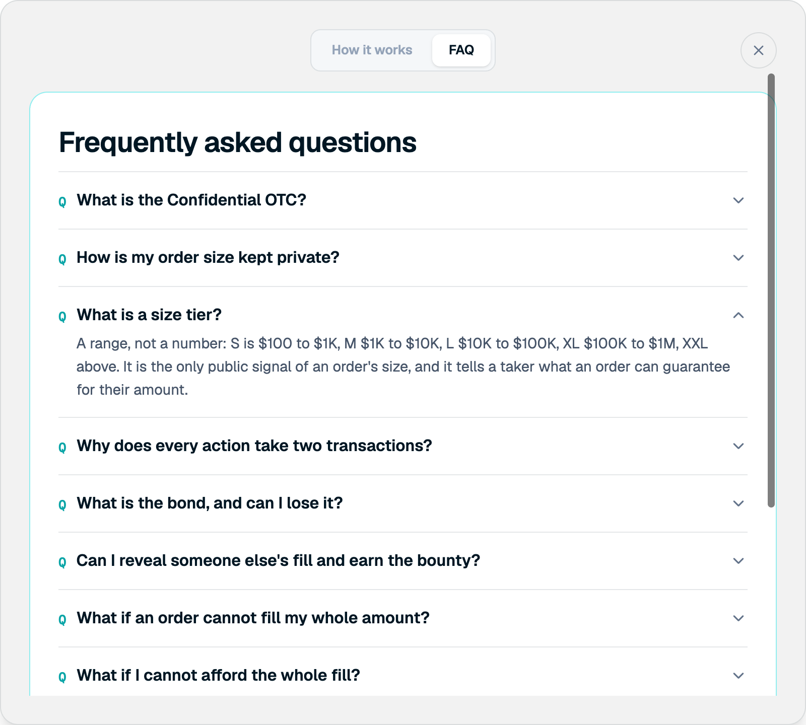

The app has its own explainer and FAQ. Both open from any Trading tab.

## How it works

<Frame>

</Frame>

The in-app explainer walks through the order lifecycle. It covers privacy, size tiers, the two-transaction design, the fill bond, expiry, and trading halts.

To open it, select **How it works** on any Trading tab.

## In-app FAQ

<Frame>

</Frame>

Short answers to the most common questions. The [FAQ](/trading/faq) in this guide expands on them.

To open it, select **How it works**, then **FAQ**.
