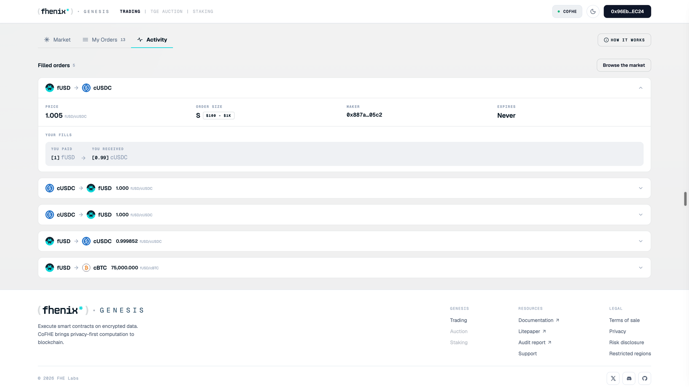

<Frame>

</Frame>

Review the fills you made as a taker. To open it, select **Trading**, then the **Activity** tab.

## Screen components

1. **Filled orders.** Lists the orders you filled, with a count beside the heading. Select an order to expand or collapse its details.
    1. **Token pair and direction.** The header shows the token you paid and the token you received. Collapsed rows also show the order's price.
    2. **Price.** The order's exchange rate and its units, for example fUSD per cUSDC.
    3. **Order size.** The order's public size tier and dollar range, not the exact amount you filled.
    4. **Maker.** The wallet address of the maker who posted the order.
    5. **Expires.** The order's expiry, or Never if no expiry was set.
    6. **Your fills.** The fills you made on that order. Each entry shows You paid and You received, with token amounts in brackets: confidential values decrypted for you.
2. **Browse the market.** Returns you to the **Market** tab to find another order.
3. **Empty state.** Shown until you fill an order, with a shortcut back to the market.

## Steps

<Steps>
  <Step title="Open Activity">
    Open **Activity** after a fill.
  </Step>
  <Step title="Confirm the fill">
    Confirm the fill and complete any pending reveal. See [Reveal after your fill](/trading/troubleshooting/reveal-after-your-fill).
  </Step>
</Steps>

