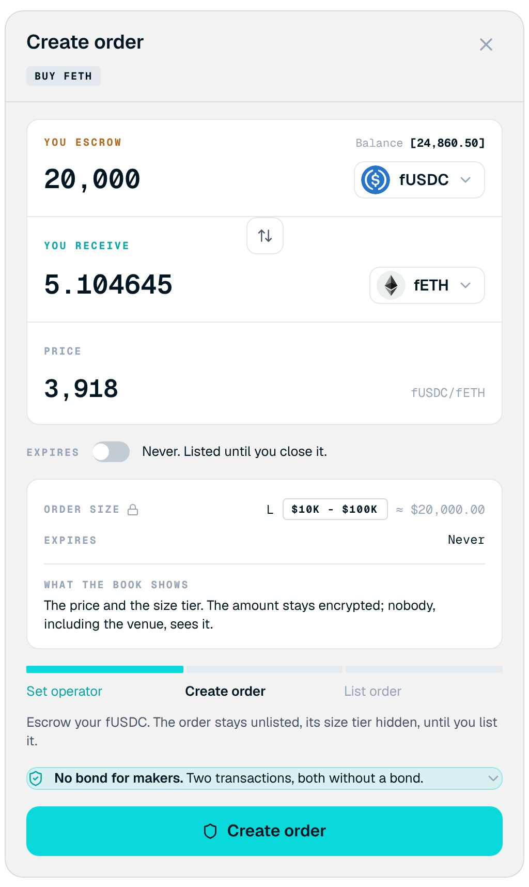

<Frame>

</Frame>

Post an order at your own price with an encrypted amount. To open it, select **Create order** on the **Market** or **My Orders** tab.

## Screen components

1. **Order direction badge.** States what the order does, for example Buy fETH.
2. **You escrow.** The amount and token you lock in the order. Your balance is shown for reference.
3. **You receive.** The amount you get back if the order fills completely.
4. **Price.** Your price, in the paying token per unit of the token you receive.
5. **Expires.** Off by default: the order stays listed until you close it. Turn it on to set an expiry.
6. **Order size summary.** The tier the book will show, and a reminder that only the price and tier are public.
7. **Step tracker.** Set operator, Create order, and List order.
8. **Bond note.** Makers post no bond.

## Steps

<Steps>
  <Step title="Set the order">
    Choose the tokens, enter the amount, and set the price.
  </Step>
  <Step title="Set an expiry (optional)">
    Turn on **Expires** and choose when the order stops being fillable.
  </Step>
  <Step title="Set operator">
    Approve **Set operator** if prompted, so the OTC contract can escrow the token.
  </Step>
  <Step title="Create the order">
    Confirm **Create order**. Your tokens move into escrow and the order is pending.
  </Step>
  <Step title="List the order">
    Confirm **List order**. This reveals the tier and lists the order in the book.
  </Step>
</Steps>

<Note>
An order is not visible or fillable until it is listed. You cannot change the price later; close the order and post a new one instead.
</Note>
