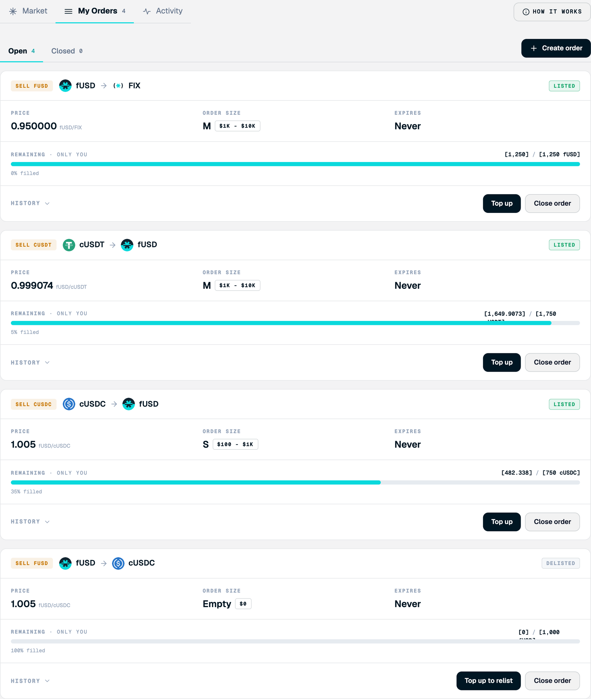

<Frame>

</Frame>

Track every order you posted. To open it, select **Trading**, then the **My Orders** tab.

## Screen components

1. **Open and Closed.** Switch between active orders and closed orders. Closed orders are fully filled, or you closed them.
2. **Order header.** Direction, the token pair, and the listing state: Listed, Delisted, or Expired.
3. **Price, order size, and expiry.** The public details of the order.
4. **Remaining.** The encrypted remaining amount against the original, with a progress bar and the percentage filled. The amount is decrypted for you, and only you can see it.
5. **History.** Expands the order's events. See [Order history](/trading/manage-orders/order-history).
6. **Top up and Close order.** Add to the escrow, or close the order and return the remaining escrow to your wallet.

## Steps

<Steps>
  <Step title="Check the order">
    Find the order and check its state and fill progress.
  </Step>
  <Step title="Top up if needed">
    [Top up](/trading/manage-orders/top-up-an-order) to add size or to relist a delisted order.
  </Step>
  <Step title="Close when done">
    Close the order when you are done to recover the remaining escrow.
  </Step>
</Steps>

<Note>
Delisted means the order was filled to nothing and left the book; **Top up to relist** brings it back. Expired means it passed its expiry and can no longer be filled; close it to get the escrow back.
</Note>
