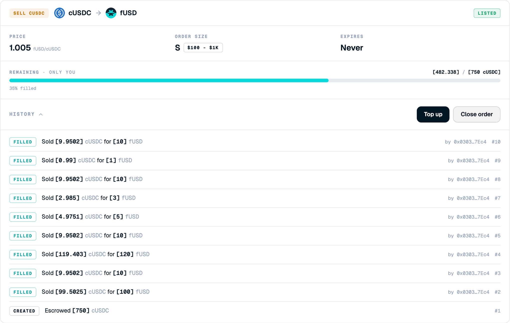

<Frame>

</Frame>

See each event on an order. To open it, expand **History** on an order in **My Orders**.

## Screen components

1. **Event type.** Created for the initial escrow, Filled for each fill.
2. **Event detail.** The amounts sold and received, decrypted for you.
3. **Counterparty and sequence.** The taker's address and the event number.

## Steps

<Steps>
  <Step title="Expand History">
    Select **History** on the order.
  </Step>
  <Step title="Review the fills">
    Review the fills in order, newest first.
  </Step>
</Steps>

