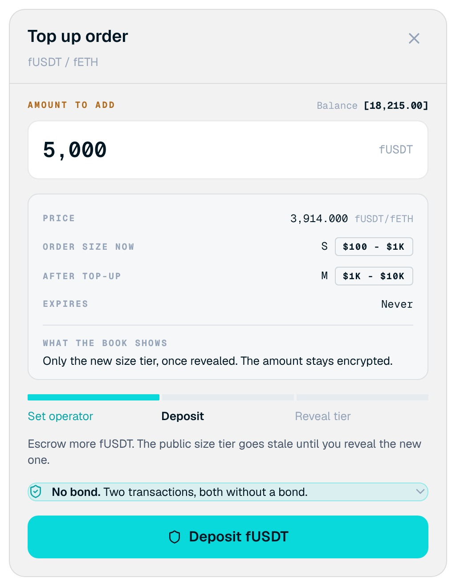

<Frame>

</Frame>

Add size to an existing order without changing its price. To open it, select **Top up** on an order in **My Orders**.

## Screen components

1. **Amount to add.** The extra amount to escrow, with your balance.
2. **Order size now and after top-up.** The current tier and the tier the book will show after the reveal.
3. **What the book shows.** Only the new tier, once revealed.
4. **Step tracker.** Set operator, Deposit, and Reveal tier.
5. **Deposit button.** Starts the first transaction.

## Steps

<Steps>
  <Step title="Enter the amount">
    Enter the amount to add and check the new tier.
  </Step>
  <Step title="Deposit">
    Confirm **Deposit**. The extra tokens move into escrow.
  </Step>
  <Step title="Reveal the tier">
    Confirm **Reveal tier** to update the book.
  </Step>
</Steps>

<Note>
Between the deposit and the reveal, the public tier is out of date. Top-ups carry no bond.
</Note>
