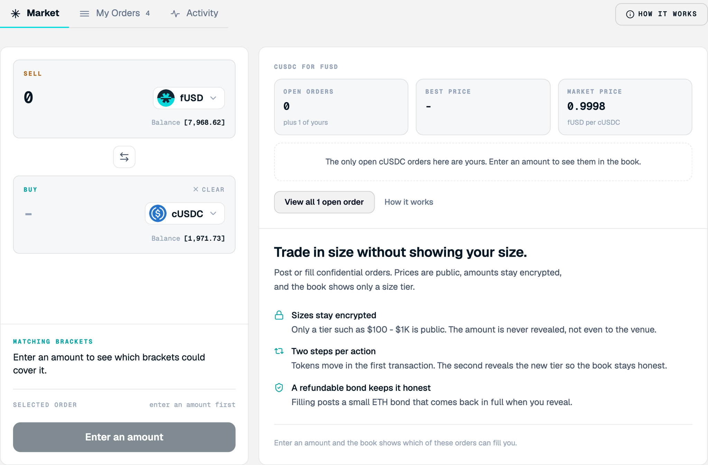

<Frame>

</Frame>

Pick a pair, enter an amount, and see which orders could fill it. To open it, select **Trading**, then the **Market** tab.

## Screen components

1. **Market, My Orders, and Activity tabs.** Switch between the order book, the orders you posted, and the fills you made. The number next to My Orders counts your open orders.
2. **How it works.** Opens the in-app explainer and FAQ.
3. **Intent panel.** Where you set what you want to trade.
    1. **Sell section.** Enter the amount you want to pay and choose the token. Your confidential balance appears in brackets.
    2. **Swap direction.** Switches the sell and buy tokens.
    3. **Buy section.** Choose the token you want to receive. **Clear** resets the amount.
    4. **Action button.** Once you select an order to fill, use this button to fill it.
4. **Matching brackets.** After you enter an amount, shows which size tiers in the book could cover it.
5. **Selected order.** Shows the order you picked to fill. The action button prompts you through each required step.
6. **Pair summary.** Open orders from other makers, the best available price, and the market reference price for the pair.

## Steps

<Steps>
  <Step title="Choose the pair">
    Choose the token to sell and the token to buy.
  </Step>
  <Step title="Enter the amount">
    Enter the amount to sell.
  </Step>
  <Step title="Pick an order">
    Review the matching brackets and the book, then pick an order.
  </Step>
</Steps>

<Note>
Balances and amounts in brackets are confidential values decrypted locally for you. Other users see only tiers.
</Note>

