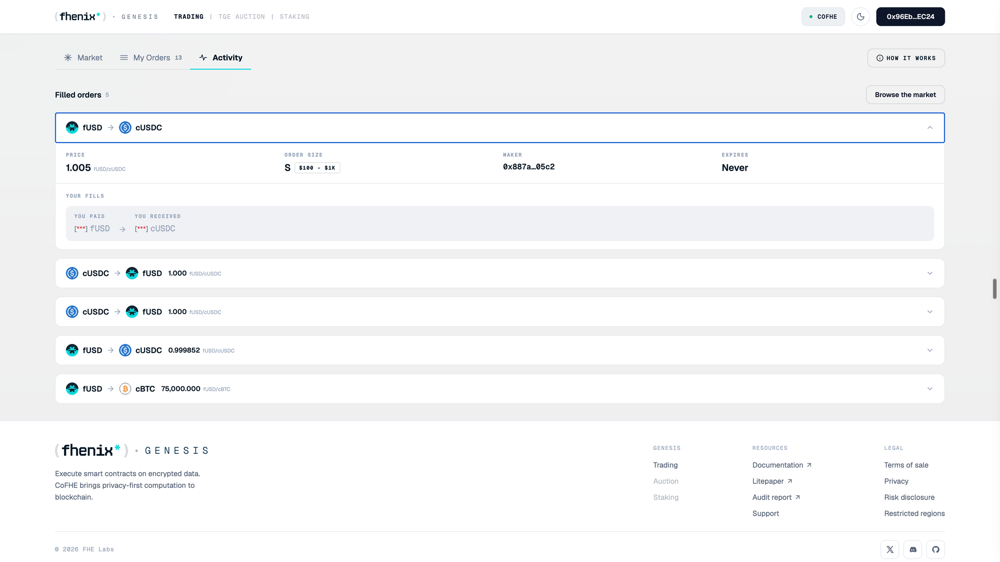

<Frame>

</Frame>

**Activity** shows **Needs you**. The fill is marked **Reveal pending**, with a **Size tier reveal needed** panel and a **Reveal size tier** button.

## Why it happens

Your fill settled, but the order's new size tier has not been published yet. Your bond is held until it is.

## How to fix it

<Steps>
  <Step title="Find the fill">
    Open **Activity** and expand the order marked **Needs you**.
  </Step>
  <Step title="Reveal">
    Select **Reveal size tier** and confirm in your wallet.
  </Step>
  <Step title="Check">
    Check that the **Needs you** badge clears.
  </Step>
</Steps>

<Note>
Reveal within the exclusive window to get the whole bond back. Once the window passes, anyone can reveal for you and keep a bounty from your bond; the rest still returns to you. Your traded tokens are not affected either way.
</Note>
