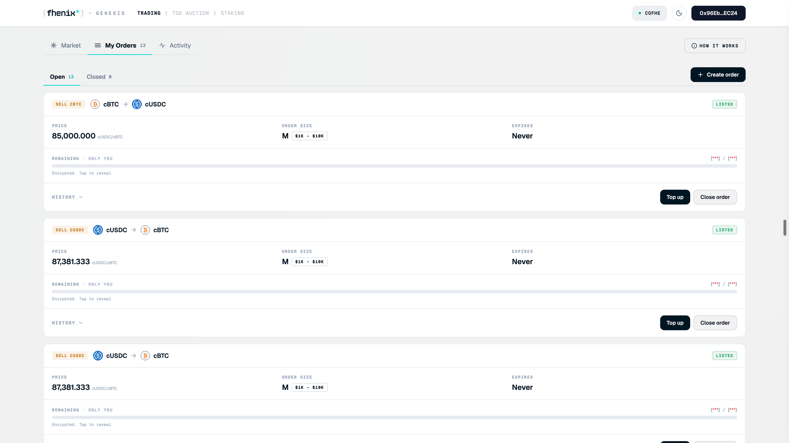

<Frame>

</Frame>

**My Orders** shows **Needs you**. The order size has a **Size updating** badge and a panel offering **Reveal size tier for them**, with the amount of ETH you keep from the taker's bond.

## Why it happens

A taker filled your order and did not reveal within their exclusive window, so the book still shows the old tier.

## How to fix it

<Steps>
  <Step title="Reveal">
    Select **Reveal size tier for them** and confirm in your wallet.
  </Step>
  <Step title="Collect the bounty">
    You pay gas and receive the bounty from the taker's bond in the same transaction.
  </Step>
</Steps>

<Note>
This is optional. Anyone can complete the reveal, and nothing moves from your escrow.
</Note>

