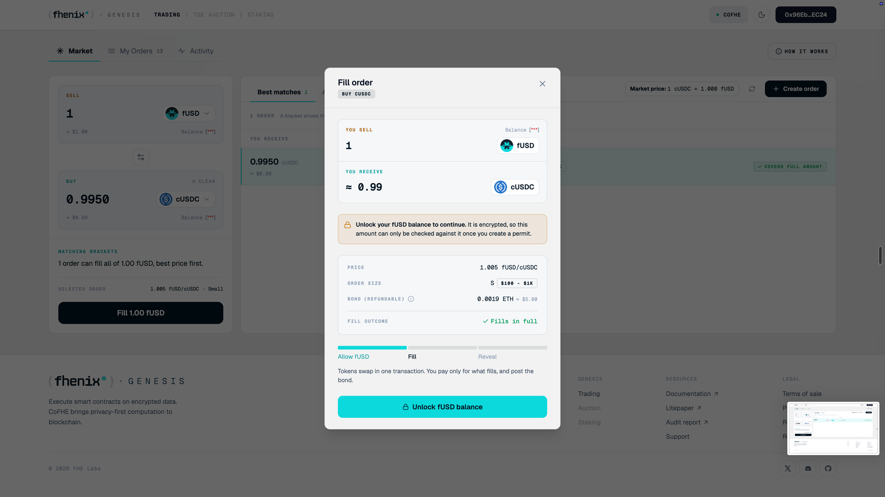

<Frame>

</Frame>

Balances and amounts appear masked as `[***]`. The **Fill order** dialog says "Unlock your token balance to continue" and its button reads **Unlock token balance**. In **Activity**, You paid and You received are masked too.

## Why it happens

There is no active Access Control Permit (ACP) for this wallet, or it has expired. Your balance is encrypted, so the app cannot check a fill amount against it until it can decrypt it for you.

## How to fix it

<Steps>
  <Step title="Start the unlock">
    Select **Unlock balance**, or open the permit status in the wallet header.
  </Step>
  <Step title="Sign the permit">
    Sign the permit request in your wallet. This is a signature, not a transaction; no tokens move.
  </Step>
  <Step title="Continue">
    Wait for balances to load, then continue.
  </Step>
</Steps>

<Note>
A masked amount is not a zero balance. It means the app cannot display it yet.
</Note>

